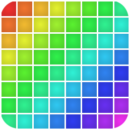

# logo-art

<p align="center">
  <a href="https://ai.enzolombardi.net/"></a>
</p>


<p align="center">
  
</p>

Convert images to Unicode/True Color ANSI art for terminal display.

Uses half-block characters (`▄`/`▀`) to pack two pixel rows per terminal line with 24-bit true color escape sequences. Algorithm ported from [dom111/image-to-ansi](https://github.com/dom111/image-to-ansi).

Since 0.3 a cell can be subdivided further than a half-block, so the same picture fits in fewer cells — see [Smaller pixels](#smaller-pixels).

## Usage

```rust
use logo_art::{image_to_ansi, print_image};

// Embed a PNG at compile time
const LOGO: &[u8] = include_bytes!("logo.png");

fn main() {
    // Print directly (width = 40 columns, height proportional)
    print_image(LOGO, 40);

    // Or get the ANSI string
    let ansi = image_to_ansi(LOGO, 80);
    print!("{ansi}");
}
```

## Build-time conversion

You can convert the image during compilation so your binary ships a pre-rendered ANSI string with zero runtime image processing.

**`build.rs`**

```rust
use std::{env, fs, path::Path};

fn main() {
    let out_dir = env::var("OUT_DIR").unwrap();
    let logo_bytes = include_bytes!("assets/logo.png");
    let ansi = logo_art::image_to_ansi(logo_bytes, 40);
    fs::write(Path::new(&out_dir).join("logo.ansi"), ansi).unwrap();
    println!("cargo::rerun-if-changed=assets/logo.png");
}
```

**`Cargo.toml`** (add a build dependency)

```toml
[build-dependencies]
logo-art = "0.3"
```

**`src/main.rs`**

```rust
const LOGO: &str = include_str!(concat!(env!("OUT_DIR"), "/logo.ansi"));

fn main() {
    print!("{LOGO}");
}
```

## Smaller pixels

A half-block cell carries two samples. The glyph inside a cell can split it further while still using only the cell's two colors, so the same image needs fewer cells:

| `Cell` | glyphs | samples per cell | font coverage |
| --- | --- | --- | --- |
| `HalfBlock` | `▀` `▄` | 1x2 | universal |
| `Quadrant` | `▘▝▖▗▌▐▚▞…` (U+2596..) | 2x2 | universal |
| `Sextant` | U+1FB00.. | 2x3 | fonts from the last few years |
| `Octant` | U+1CD00.. (Unicode 16) | 2x4 | terminals that draw the blocks themselves |
| `Braille` | U+2800.. | 2x4 | universal, one color per cell in practice |

The output footprint always follows the source aspect ratio, so a finer cell buys resolution inside the same rows and columns. To trade that resolution back for a smaller banner, ask for fewer columns: a terminal cell is about twice as tall as it is wide, which makes an octant's 2x4 grid square, so **`Octant` at half the width renders at half the height too, with the same sample count as `HalfBlock`**.

```rust
use logo_art::{Cell, image_to_ansi_with};

// Same detail as image_to_ansi(LOGO, 36), in 18x14 cells instead of 36x27.
let small = image_to_ansi_with(LOGO, 18, Cell::Octant);

// Or let the environment decide how modern the glyphs may be.
let art = image_to_ansi_with(LOGO, 18, Cell::best_supported());
```

Fidelity is the catch when an image needs more than two colors in one cell: samples are clustered into a dark and a light group and each group is averaged, and transparency always claims the background so the terminal still shows through. Flat-color logos lose nothing; photographs soften.

Octants are Unicode 16 (2024), so most fonts have no glyphs for them yet. Kitty and Ghostty rasterize the block-element ranges from their own geometry and are exact regardless of the font; `Cell::best_supported` gives octants only to those, sextants to WezTerm, and quadrants to everything else.

## API

- **`image_to_ansi(image_data: &[u8], width: u32) -> String`** — Convert image bytes to an ANSI escape code string. `width` sets the output width in terminal columns; height is derived proportionally.
- **`print_image(image_data: &[u8], width: u32)`** — Convenience wrapper that prints directly to stdout.
- **`image_to_ansi_with(image_data: &[u8], width: u32, cell: Cell) -> String`** — As above, subdividing each cell as `cell` describes. `Cell::HalfBlock` is byte-identical to `image_to_ansi`.
- **`print_image_with(image_data: &[u8], width: u32, cell: Cell)`** — Prints directly to stdout.
- **`Cell::best_supported()`** — The finest subdivision the current terminal is known to draw, from `TERM_PROGRAM`/`TERM`.

## Example CLI

```sh
cargo run --example cli -- path/to/image.png 60
cargo run --example cli -- path/to/image.png 30 octant
```

## Features

- True color (24-bit) ANSI output
- Half-block, quadrant, sextant, octant and Braille cell subdivision
- Transparency support (renders transparent pixels with default terminal colors)
- Proportional scaling from a single width parameter
- Minimal dependencies (`image` crate with PNG feature only)

## License

MIT
